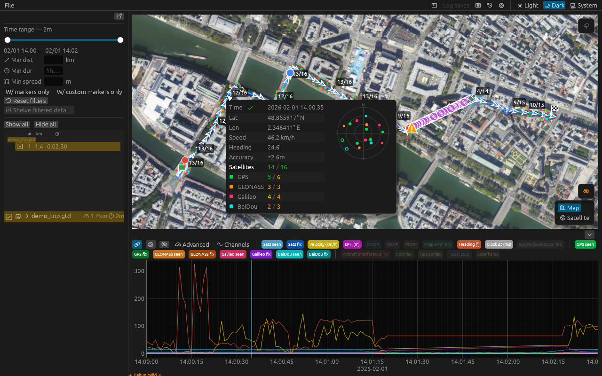
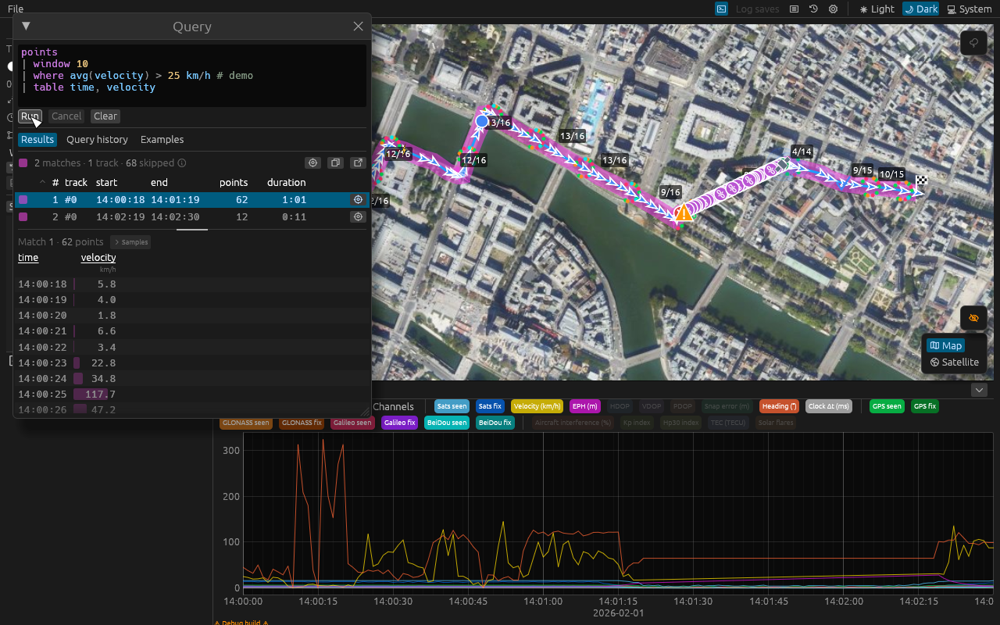

# GeoTrace

> [!NOTE]
> **Beta** - expect minor issues/quirks and frequent updates.

GeoTrace is a desktop application for inspecting GPS/GNSS navigation data.
It reads `.gtd` recording files and renders position traces, per-satellite signal quality, derived analysis metrics, and interference data on an interactive map and time-series plot.

Everything in a recording is drawn as recorded. Outliers, gaps, and bad fixes are surfaced.
Narrowing the view is done through explicit steps, such as a time span filter, per-category visibility toggles, a query, etc.



_(synthetic tiles) A short ride with multi-constellation satellite data, custom and event markers, and a 59-second tunnel fix-loss followed by gradual signal reacquisition.
The screenshot always matches the current build: it is the UI snapshot test baseline, which draws a labelled grid in place of the base map._

## Features

**Map** - OpenStreetMap and satellite basemaps, several recordings at once, drag-and-drop loading.
Track points, markers, satellite labels, and sky glyphs are drawn as vector meshes and each category can be hidden on its own.

**Time-series plot** - velocity, heading, EPH, clock delta, satellites seen and in fix per constellation, and the derived analysis metrics, plus any ad-hoc sensor channels the recording carries.
Hovering cross-highlights with the map.

**Sky plot** - polar view of the satellites in a fix, with a signal-strength heat field.
Shown per point, as a whole-track overlay on the map, and as a scrubbable trails window replaying every satellite's path across the sky.

**Analysis** - satellite utilization, loss of lock and slip rate, and clock offset excursions, computed over configurable parameters and surfaced as plot metrics and map markers.

**GNSS interference** - aircraft-reported interference from [gpsjam.org](https://gpsjam.org) drawn as a map layer and available as a metric.
Days are archived locally as they are fetched, so they stay available offline.

**Geomagnetic indices and ionospheric TEC** - Kp/Hp30 and global ionosphere maps for the days a recording spans, drawn as plot lines and queryable as metrics, with TEC also drawn as a map heatmap under the tracks.
Days are archived locally as they are fetched.

**Solar flares** - flares from NASA's DONKI catalog marked on the plot at their peak, coloured by class.
Hovering a marker shades how long that flare lasted, and hovering the chip shades every flare the view reaches into.
Needs a free [api.nasa.gov](https://api.nasa.gov) key, set in Settings.

**Environment warnings** - a toast when a loaded recording overlaps archived interference, geomagnetic activity, solar flare or TEC deviation values that reach a level known to disturb reception.
An icon in the map's corner stays up either way, and its popup states every level.

**Snap to road** - match a track against the OpenStreetMap road network with Valhalla.
The matched geometry draws on the map and the per-point distance to it becomes a metric.
Nothing is uploaded without consent, and you can optionally route requests to a custom server.

**History** - every loaded recording is stored in a local database and can be re-opened without the original file.

## Query language

A small declarative pipeline for ad-hoc analysis, written in the query window.
Matches are drawn on the map, listed in a results table, and cross-highlighted on the plot.
Expressions are unit-checked before a run, and the editor autocompletes and documents every construct as you type.

```
points
| window 10
| where spread(heading) <= 10 deg
    and avg(accel) >= 0.3 m/s2
    and avg(velocity) > 30 km/h
| draw
| table time, velocity, heading, accel
```

Every plot metric is queryable, along with the recording's own sensor channels.
A query can halo its matches, keep only them, or hide them.



## Install

> [!NOTE]
> Installers and packages are published with each tagged release.

GeoTrace is a desktop app for Linux, macOS, and Windows (x86-64 and ARM64).

Linux / macOS (shell):

```sh
curl --proto '=https' --tlsv1.2 -LsSf https://github.com/CramBL/geotrace/releases/latest/download/geotrace-installer.sh | sh
```

Windows (PowerShell):

```powershell
irm https://github.com/CramBL/geotrace/releases/latest/download/geotrace-installer.ps1 | iex
```

Homebrew (Linux / macOS):

```sh
brew install CramBL/homebrew-tap/geotrace
```

Windows installer: download the `.msi` for your architecture from the [latest release](https://github.com/CramBL/geotrace/releases/latest).

GeoTrace checks for a newer release on startup and offers to update.
Installs from the shell/PowerShell installer update in place, any other install is pointed at the downloads page.
`geotrace --update` does the same from the terminal.
The check can be turned off under Settings.

> [!NOTE]
> Releases are currently **unsigned**.
> On macOS, the first launch needs right-click &rarr; **Open** (or `xattr -d com.apple.quarantine /path/to/geotrace`).
> On Windows, SmartScreen shows **More info &rarr; Run anyway**.

## Inspect recordings from an MCP client

Start the desktop app with `geotrace --session-bridge` and open a recording.
Configure your MCP client to launch the companion from the same GeoTrace installation under the same operating system account.
The client starts the companion via standard input and output using a configuration like this:

```json
{
  "mcpServers": {
    "geotrace": {
      "command": "/absolute/path/to/geotrace-mcp"
    }
  }
}
```

On Windows, use the path to `geotrace-mcp.exe` and escape backslashes in JSON.
Stop active MCP sessions before updating GeoTrace on Windows.
The `list_recordings` tool lists the recordings that are currently loaded.
It accepts an optional `limit` and an `after` cursor.
Each page contains at most 100 recordings, which is the default limit.
Use the returned `next_after` as `after` to continue, and stop when `next_after` is null.

Pass a recording's returned `id` as `recording` to `get_recording`.
It returns the recording summary and up to 100 track references per page.
Pass its `next_after` as `after` to continue.
Pass a track reference as `track` to `get_track` for its recorded time range and counts, or to `get_range_details` for points in recorded order.
`get_track` reports distance and bounds from the map geometry when available.
Longitude bounds extend east from `longitude_start_deg` by `longitude_span_deg`, including across the antimeridian.
`get_range_details` accepts a zero-based inclusive `start` and exclusive `end`.
Use `next_start` as `start` with the same `end` to continue through pages of up to 100 points.
The tool reports exact UTC timestamps in recorded order, including across clock reversals.
The source for `time` is the receiver clock when available and the host clock otherwise.
Missing recorded coordinates and measurements appear as null.

Use recording IDs and cursors from the current desktop session.
Start again with `list_recordings` after restarting GeoTrace.
Get fresh track references with `get_recording` after changing the loaded recordings.

`list_metrics` returns the built-in query identifiers, summaries, quantities, accepted unit examples, and sources.
Metric definitions describe where values can come from, including environment archives and completed road snapping runs.
Actual values depend on the recording and time range.
The tool also lists channels from the current recordings, with units, wrap periods in degrees, and component labels.
The `reference` fields contain query expressions such as `@orientation.x`, or null for labels outside the query syntax.
When a component label repeats, its query reference selects the first column with that label.
The query checker rejects channels with conflicting definitions across loaded tracks.
The channel entry includes the total number of conflicts and up to eight diagnostic messages.
Entries with oversized channel metadata have status `metadata_omitted` and count toward the page limit.
Set `channel_limit` to request fewer than 100 channels per page.
Pass `next_channel_start` as `channel_start` for the next page.
Restart channel pagination after changing the loaded recordings.

Pass query editor text as `text` to `check_query`.
Use blank lines to separate queries, and check a query with a channel source on its own.
The result has status `valid`, `invalid`, or `empty` for text with only comments or whitespace.
Invalid results include messages, optional hints, and spans with zero-based UTF-8 byte offsets into the full submitted text.
Each span includes its start and excludes its end, with equal offsets for an insertion point.
The serialized request must fit in 4 KiB.
Check fewer query blocks at a time if the request or its diagnostics exceed the bridge limits.
For a single diagnostic that exceeds the reply limit, check that query in the GeoTrace editor.

Pass `text` to `open_query` to replace the draft in the Query window.
The tool accepts any draft that fits within the bridge request limit, including text with syntax errors.
After `query_draft_queued`, use the editor to revise the draft and run it when ready.

Submit the same `text` to `run_query` to start a background query job.
GeoTrace evaluates the tracks enabled in the track tree and applies the current global filter, including its time window.
The job has its own query text and results and leaves the Query window, query history, and map effects intact.
A start request returns status `busy` and the active job identifier while a job is active.
When GeoTrace can start a job, invalid or empty text returns the same validation result as `check_query`.

Pass the returned `job` to `get_query_status` or `cancel_query`.
GeoTrace passes the job identifier to the bridge before copying the selected track data.
If the connection closes before the reply arrives, retry `run_query` to get the active identifier or start a new job.
Poll until the status is `completed`, `cancelled`, `failed`, or `stale`.
Completion reports the match, track, and skipped counts for each query block in input order.
The status reports `stale` when the current recording data, filter, enabled tracks, or derived inputs differ from the run's inputs.
GeoTrace retains one job until another query starts or the desktop session ends.

For a completed job, pass its `job`, the zero-based `query` block index, and a `page` of `{"kind":"matches"}` to `get_query_results`.
The match page lists each match's track reference, half-open range, first and last timestamps, and aggregate values.
The match position uses zero-based ordinals for the matching track group and the match within that group.
Pass its `next_start` as `page.start` to continue with the same job and query.
To read the table rows of one match, set `page.kind` to `rows` and pass the match's `position` as `page.matched`.
Omit `page.start` for the first row, then pass the row page's `next_start` as `page.start` to continue.
A null `next_start` marks the final page.
Point indices refer to the original track, and point times use RFC 3339 UTC.
Channel indices refer to the filtered sample timeline, and sample times use Unix seconds.
Column ordinals give the table order across match aggregates and row values.
Point metrics and aggregates use evaluator units, with ratios expressed as fractions and the `time` metric in Unix seconds.
Channel components use the track's declared unit.
Cells have status `finite` with a numeric value, `missing`, or `non_finite`.
Both page kinds return at most 100 entries and 2,048 values.
Column metadata that exceeds 64 KiB causes a size error.

Pass a `target` with `kind` set to `track` and a checked `track` reference to `show_on_map` to frame and highlight its visible path.
Set `target.start` and `target.end` for a half-open range of original point indices, or omit them for the whole track.
To frame a retained point-query match, pass a `target` with `kind` set to `query_match`, the same `job` and `query` used in `get_query_results`, and the match's `position` as `target.matched`.
Channel sample ranges produce an error.
Range highlighting uses the map's Query highlights setting.
Pass a `track` and a zero-based `point` index to `open_point` to center the map and open point information.
Both tools use the current filters and visibility and report an error for a target with no visible geometry.
The `map_presentation_queued` status acknowledges the request.
GeoTrace applies the request when the map next draws if the recording, filter, query run, and target visibility still permit it.
A later camera request supersedes a queued request.
A later pin change supersedes a queued point request.
Use Query highlights to hide or show an active range.
GeoTrace clears a `show_on_map` match highlight when its job becomes stale or another job replaces it.

Pass the same `target` to `show_on_plot` to open the plot and frame the selected timestamps.
For a channel match, GeoTrace frames the retained sample times and enables the matched channel.
Use the optional `metrics` array to enable plot metrics by their query identifiers, such as `velocity` and `eph`.
GeoTrace reports an error for a query identifier with no corresponding plot metric.
GeoTrace frames visible timestamps even when a selected metric has missing values.
The `plot_presentation_queued` status acknowledges the request.
GeoTrace applies a current request on the next frame with a visible plot area.
With Sync to map enabled, the plot keeps that time range until the map's visible time range changes or the user changes the plot view.

## Network access

Map tiles and the update check are requested on their own, as is the day data of a loaded recording: aircraft interference, geomagnetic indices from GFZ, ionosphere maps from JPL (or the CDDIS archive once you set an Earthdata token), and solar flares, with an [api.nasa.gov](https://api.nasa.gov) key of your own.
For each recording day the 27 ionosphere map days before it are downloaded as well, which is what the TEC deviation warning measures against.
Those requests contain the UTC days they cover and nothing from the recording.
Snap to road reaches out for its own data too, and uploads track coordinates only after explicit consent.
Every host is configurable, and `--offline` runs GeoTrace with no network access.

## SDKs

> [!NOTE]
> SDK packages are published on their own release cadence, separate from the app.

GeoTrace defines an open binary format (`.gtd`) for storing navigation recordings.
SDKs are available so you can produce `.gtd` files from any data source and open them in GeoTrace.

A recording carries nav fixes, satellite reports, annotations, event markers, ad-hoc sensor channels, and recording metadata.

All SDKs are MIT licensed and can be embedded in proprietary applications.

### Rust SDK

```sh
cargo add geotrace-sdk
```

```rust
use geotrace_sdk::{Angle, DateTime, NavFileBuilder, NavFix, NavFixTime, Utc};

let t = "2024-01-15T09:00:00Z".parse::<DateTime<Utc>>()?;
let mut recorder = NavFileBuilder::new().open();
// add() dispatches by type: NavFix, SatelliteReport, Annotation, or EventMarker.
recorder.add(
    NavFix::builder()
        .time(NavFixTime::Receiver(t))
        .lat(Angle::degrees(51.5074))
        .lon(Angle::degrees(-0.1278))
        .build(),
);
let nav_file = recorder.finish()?;
nav_file.write_to_file("track.gtd")?;
```

Examples: [`docs/sdk/rust.md`](docs/sdk/rust.md).

### C SDK

A C99 API over the `.gtd` encoder/decoder, for embedding in any language with a C FFI.
Install (Homebrew, prebuilt archive, or source) and examples: [`docs/sdk/c.md`](docs/sdk/c.md).

### C++ SDK

A header-only C++17 wrapper over the C SDK, with RAII types and range-based iteration.
Install and examples: [`docs/sdk/cpp.md`](docs/sdk/cpp.md).

### Python SDK

```sh
uv add geotrace-sdk
# or: pip install geotrace-sdk
```

```python
from datetime import UTC, datetime
from geotrace_sdk import NavFileBuilder, NavFix

recorder = NavFileBuilder()
recorder.add(NavFix(lat=51.5074, lon=-0.1278, gps_time=datetime(2024, 1, 15, 9, 0, 0, tzinfo=UTC)))
recorder.finish().write_to_file("track.gtd")
```

Examples: [`docs/sdk/python.md`](docs/sdk/python.md).

## Development

Use [`just`](https://just.systems) to run common tasks:

```
just --list
```

Before committing, run `just ci` and fix any errors or warnings.

See [`CODE_STYLE.md`](CODE_STYLE.md) and [`DESIGN.md`](DESIGN.md) for project conventions.

## License

GeoTrace uses a split-licensing model.

- **Core application and internal crates** - AGPL-3.0.
  See [`LICENSE`](./LICENSE).
- **SDKs** (`geotrace-sdk`, C SDK, C++ SDK, Python SDK) - MIT.
  See [`sdk/rust/geotrace-sdk/LICENSE`](sdk/rust/geotrace-sdk/LICENSE).
  The SDKs can be embedded in proprietary applications without triggering the AGPL terms of the core application.

Map tiles and road-network matching build on [OpenStreetMap](https://www.openstreetmap.org/copyright) data.
Interference data is published by [gpsjam.org](https://gpsjam.org) from [adsbexchange.com](https://adsbexchange.com) reports.
Kp and Hp30 index data is published by the [GFZ German Research Centre for Geosciences](https://kp.gfz.de) under [CC BY 4.0](https://creativecommons.org/licenses/by/4.0/).
Global ionosphere maps are published by [NASA JPL](https://sideshow.jpl.nasa.gov) and archived by [NASA CDDIS](https://cddis.nasa.gov).
Solar flare data comes from the [NASA DONKI](https://ccmc.gsfc.nasa.gov/tools/DONKI/) catalog.
